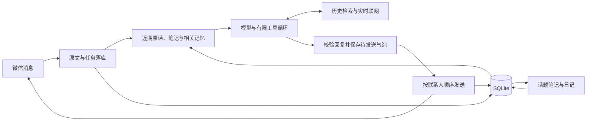

# ATRI 2.0 实现设计

状态：已实现；2026-09-14。本文描述当前代码，替代重构前的 v0.2 讨论稿。使用方法见 [部署说明](deployment.md)，已完成和待完成的验证见 [验证记录](validation.md)。

## 边界与模块

一个 Node.js 24 应用进程通过 Docker Compose 部署，使用本地 SQLite WAL。微信私聊为主要入口，面向单个陪伴角色；不同联系人各自保存经历，不共享记忆。管理页的本地试聊也独立保存。

| 模块           | 职责                                                   |
| -------------- | ------------------------------------------------------ |
| apps/api       | Fastify 管理接口、静态管理页、微信适配、配置与嵌入服务 |
| packages/core  | 对话循环、上下文、信息工具、日记、话题笔记和主动联系   |
| packages/ilink | 微信登录、协议、媒体与收发                             |
| packages/llm   | 模型接口适配与向量嵌入客户端                           |
| packages/net   | 公共私网/回环地址判断（网页读取与媒体下载共用）        |
| packages/db    | 原始消息、持久任务、投递记录、记忆、日记、检索和备份   |

不再运行 Android、Worker、Redis、向量服务、多节点协调或多角色平台。旧数据不迁移，旧版本保留在 Git 历史中。

## 一次对话

输入与任务在同一个短事务保存，可靠保存后推进微信游标。同一联系人串行处理，默认 800 毫秒内的连发合并成一轮；各条原文独立保存。不同联系人最多同时处理三个。

普通回复通常只调用一次模型。需要信息时，最多两轮工具调用、四次工具执行；含一次可选格式修复在内，最多四次模型生成。单轮总时限默认 90 秒，单次模型请求默认 45 秒。每次成功的模型调用记录 token 数与耗时。

工具分两组。资料组恒定可用：search_memory、read_history、web_search、open_page。沙箱组仅在设置里开启沙箱后出现：run_command、write_file、read_file、list_files——命令只落在一个专用目录里（Linux 生产环境由 nsjail 命名空间隔离：系统目录只读、应用与数据库被遮蔽、可按开关允许联网），关闭沙箱时这些工具既不进入工具表也无法被调用。模型读资料、提出回复与记忆更新，代码限定联系人范围、校验依据并执行写入。

回复是有序的 messages 数组，文字和目录内的表情可以混排。代码保存全部气泡后逐个发送。无效表情不会变成原始协议文本发给用户。

## 人物与情绪

四份提示词分别管理 persona、chat、diary、context_notes。管理页可以修改人物设定，还支持多人格：新建/编辑/删除人格模板、按联系人绑定人格、从预设（温柔陪伴/毒舌损友/学习监督）起步、配置首次通过好友时的开场白；其他行为规则集中在 shared/prompts。

关系与情绪表达来自人物基础、当前对话、记忆与日记。没有好感度、关系阶段或独立自我模型。在此之上有一个**轻量心情状态**：每个联系人三个维度（愉悦度/能量/耐心），由对话事件规则（感谢/抱怨/深夜/一句话敷衍等）和模型自评（moodPulse，每轮限幅）打脉冲，离线时按各自的半衰期回落向中性（愉悦 12 小时、能量 4 小时、耐心 10 小时），静默期间不升级。耐心是“不想应酬”那条轴：回得短、少追问，但不是生气，对方真有难处时仍然要好好接住。心情以体感文字进入提示词（“心情还有些低落，那是 2 小时前留下的”），从不输出数值。这解决的是“她记得上次聊完的心情”，与时间感知（她知道隔了多久）互补。

日记是第一人称回看。可以表达感受与不确定的理解，但不能为离线时间虚构见闻，也不能把角色的推测升级成用户明确说过的事实。

## 真人化行为

- **开环记忆**：对方提到有明确时间的安排时，模型在 openLoops 里记录 {content, dueAt/due, sources, recurring}；due 支持毫秒时间戳或“明天 08:00”这类本地时间（按配置时区解析）。到期后进入提示词“未完的约定”，问过一次即标记；对方汇报结果时用 resolveLoops 了结（不用等到期）；七日无人理会的过期静默退场。生日纪念日用 recurring:"yearly"，了结即自动排到明年。
- **软惦记**：没有具体日期的持续事件（这周在赶项目、准备答辩、和家里闹别扭），或者她答应过的事（下次讲那个故事），会记成一条“挂念”。它不会主动发消息，也不占开环配额；默认 2 天后、且只在话题自然相关时问一句，问过就不再追问。最多同时 3 条，14 天无人了结就静默过期；对方说事情过去了或“别管了”时立即关闭。
- **读空气**：连续两次主动消息没有回应后，冷却从 12 小时拉长到 3 天，对方一回话立即解除；聊天中对方连续三条回复都极短时，提示词注入“收着点说”。
- **主动联系分层**：日常问候每天最多一次；到期的开环有**独立配额**（仍受安静时段与读空气刹车约束），惦记不会被日常挤掉。主动消息的提示词带她日记里最近的真实感受和以往开场白，防止干巴巴和重复开场。
- **作息节律**：从近 14 天的用户消息统计 24 小时桶，阈值随总量浮动（`max(3, 总消息/24/2)`，至少 3 条）判定习惯时段，注入提示词；不在活跃时段时提示可以关心“这个点还没睡”。
- **气泡节奏**：多气泡发送间隔随下一条长度变化（约 0.4–2.5 秒），不再是固定 120ms 的机关枪。
- **长度镜像**：回复长度参照对方消息长度，一句话对一句话。

## 记忆分工

| 数据         | 用途                                                           |
| ------------ | -------------------------------------------------------------- |
| 原始对话     | 保存说话人、原文、时间、附件引用和已发送内容，作为可核对的依据 |
| 当前话题笔记 | 保留长对话中的指代、纠正和未完事项，减少反复塞入完整历史       |
| 长期记忆     | 带来源的偏好、事实、约定和主观理解                             |
| 日记段落     | 回看真实经历及感受，同时参与后续检索                           |

进入提示词的长期记忆不再简单截取最新若干条，而是按“被引用次数、记忆类型（用户明确说过的 stated 权重高于主观推断）、时间新近度（14 天半衰期，设下限防止旧事实被新推断淹没）”混合排序，每次被召回、进入提示词或被更正都会累积引用计数。这样高频聊天也不会把生日、忌讳这类旧事实挤出上下文。管理页可置顶记忆，置顶条目永远参与提示词且不受预算裁剪；与召回重复的记忆只出现一次，省出的预算留给别的记忆。刚注入过的记忆有冷却期，冷却中的条目排到后面让位置轮换，最强的前几条不参与轮换、每轮都在。预算不够时按价值从低到高丢弃（非置顶、主观推断、低重要性先走），而不是截掉列表尾部。

提示词内的记忆以紧凑条目渲染（内容 + 引用 id + 类型），不再携带 hits、时间戳等模型用不到的字段；表情目录按天轮换窗口并下沉近期用过的表情，长目录的尾部也能被用到。

默认模型窗口配置为 65,536 token，每次模型请求的输入预算为 24,000，输出上限为 3,000，并保留 1,024 token 协议余量。这些值可以在网页“调试与设置”直接修改；窗口需要按提供商说明填写，程序不会自动识别模型的真实容量。输入、输出和余量之和不能超过窗口，非法修改不会写入。同时处理的联系人数（默认 3）与连发合并窗口（默认 800 毫秒）也在管理页可调。

计数采用跨提供商的保守估算：ASCII 按约 3 个字符一个 token，其他 Unicode 字符按每个 2 token，图片按每张 4,096 token 估算；还计入工具定义、消息和续传内容。它不是模型专用 tokenizer，不能保证实际用量完全一致。调试页单独显示供应商返回的输入、输出用量与耗时；接口未报告用量时记录为 0。

近期原话优先保留，再放入有限长度的笔记、少量近期认识和自动相关召回。初始输入尽量为工具续接留出最多 6,000 token；工具结果也限制在剩余预算中。每次请求前再次检查估算用量。最新原话和必要提示词本身超限时，保留原文并报错，管理员可增加预算或缩短人物设定、消息后重试。日记和话题整理同样受输入预算约束，日记的生成上限也不会突破网页设置。

长对话整理话题笔记的阈值和日记分批大小来自共享常量（packages/core/src/constants.ts）。

未整理原文接近预算或达到近期记录窗口时，才创建话题笔记任务。整理保留原始记录；模型可用检索和来源 ID 找回较早的内容。

检索默认使用 SQLite FTS5 与中文子串匹配；在管理页开启“向量检索”并填写模型名后，聊天与检索会改为混合模式：原文、记忆和日记在后台以 OpenAI 兼容 /embeddings 接口生成向量（保存在同一 SQLite 中，内容更新即失效重建），查询时先做词面召回，再按余弦相似度给结果加权，使换一种说法的旧事也能被找回。未配置向量模型时行为与纯词面检索完全一致。关键词重合仍占主导地位；完全无词面重合的语义召回依赖向量质量，建议选择中文效果好的嵌入模型。词面打分按 IDF 加权，中文二元组里常见词的权重被压得很低；自动召回另有一道稀有度闸门——候选的最稀有命中词如果在本语料里过于常见（“有点”这类），该候选直接排除，只有语义相似度足够高的例外。自动召回默认只放 3 条，宁缺毋滥。

明确纠正可替代旧记忆，被替代的条目退出默认召回；更正会继承原记忆的引用计数。删除原文会连带删除其向量。

日记在使用者时区的指定小时之后增量处理此前日期的新消息，默认凌晨 3 点。较长的一天分批整理；手动“整理日记”也可纳入今天的消息。每段必须引用本批原文，没有值得写的内容时可以为空。离开超过两天再回来时，还会取出这段间隔内的日记段落与时间间隔一起构成语境：三天没见不该像什么都没发生过，她也不必假装记得没写过的事。

这不是模型权重学习，也没有实现 DeepSeek Engram 结构或调用 Codex 专用上下文压缩接口。借鉴的是“小循环、有限上下文、可检索历史、按需读取”的工作方式。

## 确定的数据规则

- 所有来源、历史和检索查询都限定在当前联系人。
- stated 需要对话原文依据；interpretation 保留主观理解的身份。日记来源不能直接写成 stated。
- 检索保留 user 与 assistant，避免把角色自己的发言记成对方的偏好。
- 未确认发送的角色发言不进入历史索引，不能作为已发生的承诺被引用。
- 相同内容与来源重复写入时保持幂等，记忆不能把另一条记忆当作新的证据。
- 新消息或管理更正会更新联系人版本。旧草稿提交时作废；后台任务中的旧认识不能覆盖新更正。
- 管理更正添加一条明确标识的修正记录，并原子替代旧认识、清空旧话题笔记。
- 删除原文会使依赖它的日记和记忆失效，并清理笔记与检索索引，处理范围覆盖全部历史。
- 删除记忆不会删除对应原文；若要忘记整段经历，需要删除原文。既有备份和微信已送达消息不受管理页删除操作影响。

这些规则保证来源和写入一致性。模型是否准确理解来源、是否自然使用记忆，仍需实际模型场景评估。

## 消息可靠性

使用协议稳定 ID；缺少 ID 时由发送方、时间、正文及媒体生成指纹。没有稳定 ID 或时间的事件使用批次游标和位置回退，这种协议输入下无法保证跨批次严格去重。

任务与发送状态持久保存。新输入使尚未发送的旧草稿失效；已经发送的气泡保留，后续按已确认状态继续。已确认气泡不会重新生成并重发。

发送失败与送达不明分别记录。服务重启遇到“发送中”时改为“送达不明”，暂停该联系人的队列；送达不明的记录 10 分钟（`UNCERTAIN_HOLD_MS`）后自动放行，避免一条无法确认的记录把联系人永久卡住——期间运维仍可在管理页确认或跳过。管理页显示联系人、原消息和错误，允许确认已收到、重发或跳过；失败任务可以重试，也可以忽略，否则已评估过的错误会一直留在待处理里。重试沿用同一个 client_id，但微信端是否严格去重由协议能力决定。

备份恢复也会暂停历史任务和未确认投递。应用按单实例运行，共享同一数据库启动多个应用实例不在支持范围内。

## 微信与联网

ilink 源码和原测试来自 WeChat-AI 的 cf8fbec，保留来源许可。应用层重新实现队列、管理、SQLite 和日记记忆逻辑。

表情通过图片发送，支持模型在 JSON 回复中引用目录内 slug。模型偶尔会模仿历史记录的展示格式、把 [表情：…] 写进文字；发送前会把这些片段按 slug、含义或标签模糊匹配回目录中的真实表情重新作为图片发送，匹配不到的片段会被静默删除，聊天里永远不会出现协议原文。提示词同时注入最近发送过的表情，要求不要连续重复同一张。支持视觉的模型可读取最近的图片，画面描述以“模型观察”标识并进入后续检索。未启用视觉或附件不可读时不假装看到图片。语音仅利用接口自带转写。

每轮的时间信息（当前时刻、距上一条消息的间隔、心情、记忆与召回）不写进系统提示词，而是作为一条 user 角色的【系统资料】消息插在历史之后、本轮原话之前。系统提示词只放稳定内容，于是跨轮的前缀逐字节不变：OpenAI 兼容与 DeepSeek 接口自动命中前缀缓存，Anthropic 接口则在稳定前缀末尾挂 cache_control 断点，缓存覆盖的部分不重复计费。间隔按档位处理：连续聊天、几小时、隔天、三天到一周、两周以上、超过一个月各有不同的开场方式，间隔越久第一轮越短。

Tavily 搜索返回链接、查询时间及可获得的发布时间。open_page 校验公开 HTTP/HTTPS 地址、DNS 结果及重定向，限制响应长度；动态网页和受访问限制页面可能无法读取。网页与历史均作为资料，不能改变工具权限或联系人范围。

主动联系默认关闭。开启后，至少沉默指定小时、处于安静时段外才尝试；日常问候每天最多一次且与上次主动发送至少相隔 12 小时，尝试时间带 0–20 分钟随机延迟，避免每天同一分钟发起。使用同一对话和投递流程，模型没有自然话题时可以跳过；到期的开环（见“真人化行为”）走独立配额，安静时段和读空气刹车同样适用。

用量表按 30 天滚动归档：更早的调用聚合成按日汇总，状态页不再对无限增长的明细表做全表聚合。记忆列表按联系人版本号缓存，写路径（写入、更正、置顶、删除、计数）全部显式失效。

## 运维

服务提供 /healthz 与密码保护的管理接口。管理登录使用 HttpOnly、SameSite Cookie；部署为 HTTPS 时开启 Secure Cookie。模型和搜索密钥不在管理 API 中回显。账号会话、已保存的模型配置和聊天内容位于数据卷，应一起备份并限制访问。

Docker 镜像内是应用、静态资源与内置的 nsjail（及其运行库，为沙箱隔离所用）；默认数据卷挂载到 /data，沙箱工作目录单独使用 /sandbox 卷（nsjail 会把 /data 遮蔽成空 tmpfs，沙箱目录必须独立于它才能存活）。compose 需要 `privileged: true`——nsjail 要在容器内建挂载树，Docker 默认安全配置不给这个权限。备份使用 SQLite 一致快照，包含被引用的媒体、自定义表情和文件校验清单。恢复必须指向空数据目录，避免覆盖现有实例。
